# FERRORAMA
## Manual de Utilização do Sistema

**Sistema de Gerenciamento Ferroviário**

| Informação | Descrição |
|---|---|
| Projeto | Ferrorama |
| Documento | Manual de Utilização |
| Versão | 1.0.0 |
| Finalidade | Orientar os usuários na utilização do sistema |

---

#  Sumário

1. [Apresentação do sistema](#1-apresentação-do-sistema)
2. [Requisitos para acesso](#2-requisitos-para-acesso)
3. [Acesso ao sistema](#3-acesso-ao-sistema)
4. [Login e logout](#4-login-e-logout)
5. [Conhecendo a interface](#5-conhecendo-a-interface)
6. [Dashboard](#6-dashboard)
7. [Gerenciamento de usuários](#7-gerenciamento-de-usuários)
8. [Gerenciamento de trens](#8-gerenciamento-de-trens)
9. [Gerenciamento de viagens](#9-gerenciamento-de-viagens)
10. [Gerenciamento de sensores](#10-gerenciamento-de-sensores)
11. [Perfis e permissões de acesso](#11-perfis-e-permissões-de-acesso)
12. [Mensagens e orientações do sistema](#12-mensagens-e-orientações-do-sistema)
13. [Boas práticas de utilização](#13-boas-práticas-de-utilização)
14. [Solução de problemas comuns](#14-solução-de-problemas-comuns)
15. [Considerações finais](#15-considerações-finais)

---

# 1. Apresentação do sistema

O **Ferrorama** é um sistema web desenvolvido com o objetivo de auxiliar no gerenciamento e na organização de informações relacionadas ao ambiente ferroviário.

A aplicação permite administrar usuários, trens, viagens e sensores, reunindo essas informações em um único ambiente para facilitar o acompanhamento e a consulta dos registros.

O sistema foi desenvolvido utilizando tecnologias como PHP, MySQL, HTML, CSS e JavaScript, integrando a interface visual, as funcionalidades do servidor e o banco de dados.

### 1.1. Objetivo do manual

Este manual tem como finalidade orientar pessoas que ainda não conhecem o Ferrorama, apresentando os procedimentos necessários para acessar o sistema, navegar pelas telas e utilizar suas principais funcionalidades.

As instruções estão organizadas em etapas para facilitar a compreensão e permitir que o usuário realize as operações sem precisar de auxílio constante dos desenvolvedores.

### 1.2. Principais funcionalidades

O Ferrorama disponibiliza funcionalidades para:

- Gerenciar contas de usuários e funcionários.
- Cadastrar e consultar trens.
- Registrar e consultar viagens.
- Cadastrar e organizar sensores.
- Consultar informações gerais por meio do dashboard.
- Controlar o acesso de acordo com o perfil do usuário.

---

# 2. Requisitos para acesso

Para utilizar o sistema, é necessário que o ambiente de execução esteja configurado corretamente.

### 2.1. Recursos necessários

- Computador com acesso ao sistema.
- Navegador de internet atualizado.
- Servidor Apache em funcionamento.
- Banco de dados MySQL em funcionamento.
- Aplicação Ferrorama instalada e configurada.
- Conta de usuário cadastrada.

### 2.2. Inicialização do ambiente

Quando o sistema estiver instalado em um computador utilizando XAMPP, siga as etapas:

1. Abra o painel de controle do XAMPP.
2. Localize o serviço Apache.
3. Clique em **Start** para iniciar o servidor.
4. Localize o serviço MySQL.
5. Clique em **Start** para iniciar o banco de dados.
6. Verifique se os dois serviços estão funcionando corretamente.

Após iniciar os serviços, o sistema estará disponível para acesso pelo navegador.

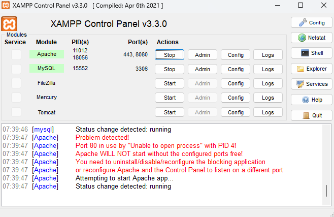

*Legenda: Serviços necessários para executar a aplicação Ferrorama.*

---

# 3. Acesso ao sistema

O Ferrorama é acessado por meio de um navegador de internet.

Para abrir a aplicação:

1. Abra o navegador de sua preferência.
2. Digite o endereço configurado para o sistema.
3. Pressione Enter.
4. Aguarde o carregamento da página inicial.

Exemplo de endereço para ambiente local:

`http://localhost:8080/julia_muller_2026/sa_ferrorama`

O endereço pode ser diferente dependendo da configuração utilizada no computador ou servidor de demonstração.

Ao acessar corretamente, será apresentada a tela de login.

*Legenda: Página de entrada do sistema.*

---
### Conheça nosso projeto

Na tela de login, além dos campos para inserir e-mail e senha, o Ferrorama disponibiliza a opção **“Conheça nosso projeto”**. Ao clicar nesse link, o visitante é direcionado para uma página de apresentação do sistema, onde pode conhecer melhor o projeto, sua proposta e seus objetivos.

Essa funcionalidade permite que qualquer pessoa conheça a finalidade do Ferrorama, mesmo sem possuir uma conta ou realizar o login no painel.

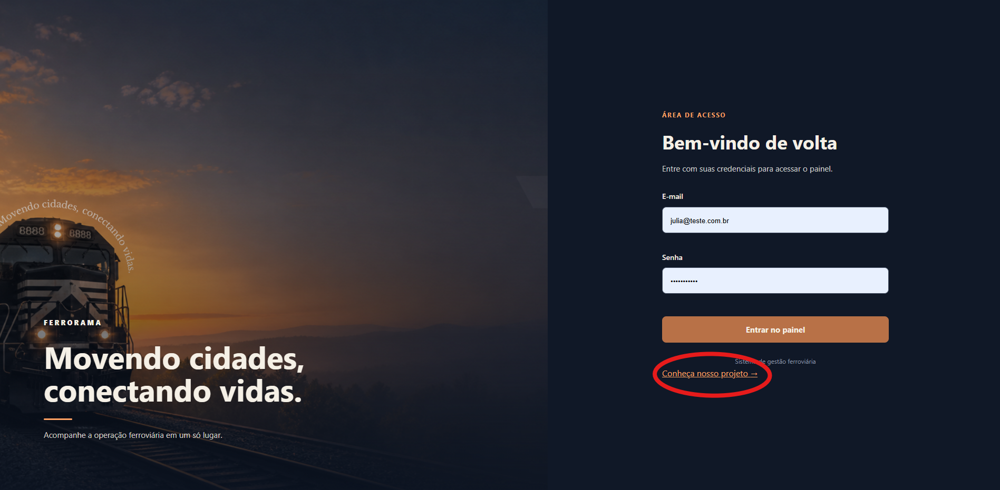
---

# 4. Login e logout

O acesso às funcionalidades do Ferrorama é realizado por meio de autenticação. Cada usuário deve utilizar suas próprias credenciais.

## 4.1. Como realizar login

Para entrar no sistema:

1. Acesse a página inicial do Ferrorama.
2. Localize o campo de e-mail.
3. Digite o endereço de e-mail cadastrado.
4. Informe a senha correspondente.
5. Clique no botão **Entrar** ou equivalente.
6. Aguarde a validação das credenciais.

Quando as informações estiverem corretas, o usuário será direcionado para a área principal do sistema.

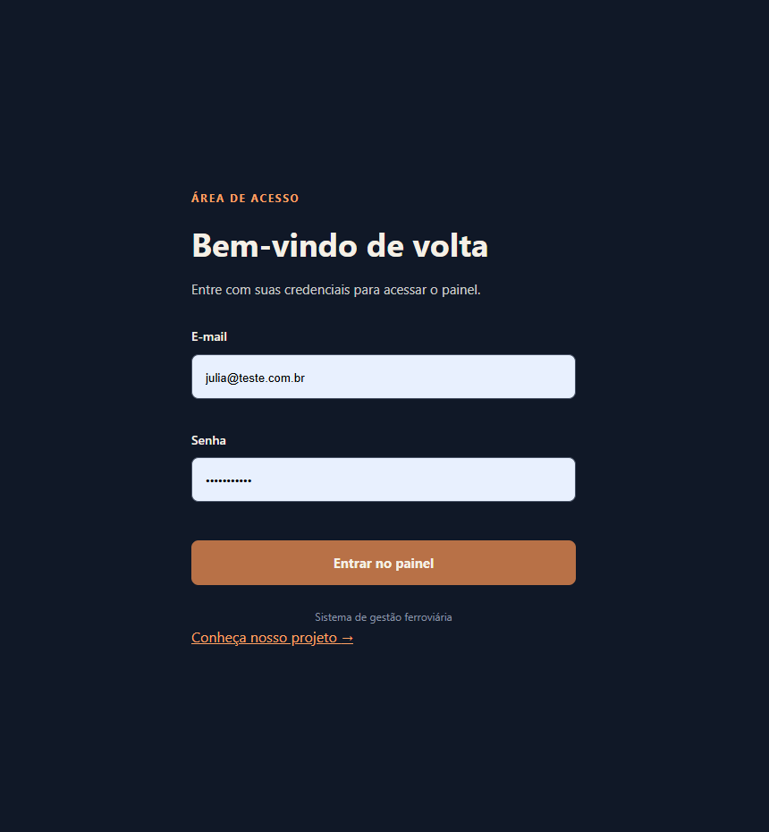

*Legenda: Exemplo de preenchimento dos campos de autenticação.*

## 4.2. Login com informações incorretas

Caso o e-mail ou a senha estejam incorretos, o sistema não permitirá o acesso.

Nessa situação:

1. Verifique se o e-mail foi digitado corretamente.
2. Confira se a senha corresponde à conta cadastrada.
3. Tente realizar o acesso novamente.

O sistema deverá apresentar uma mensagem informando que as credenciais não foram reconhecidas.

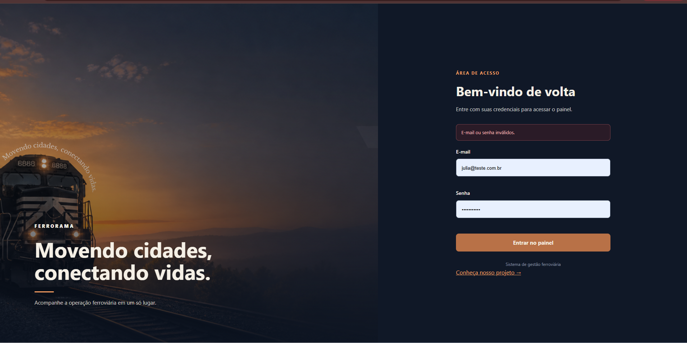

*Legenda: Exemplo de retorno apresentado quando as credenciais são inválidas.*

## 4.3. Como realizar logout

Para encerrar corretamente o acesso:

1. Localize a opção **Sair** ou **Logout** na interface.
2. Clique na opção.
3. Aguarde o encerramento da sessão.
4. Verifique se o sistema retornou à tela de login.

O logout é importante para impedir que outra pessoa utilize uma sessão que permaneceu aberta.

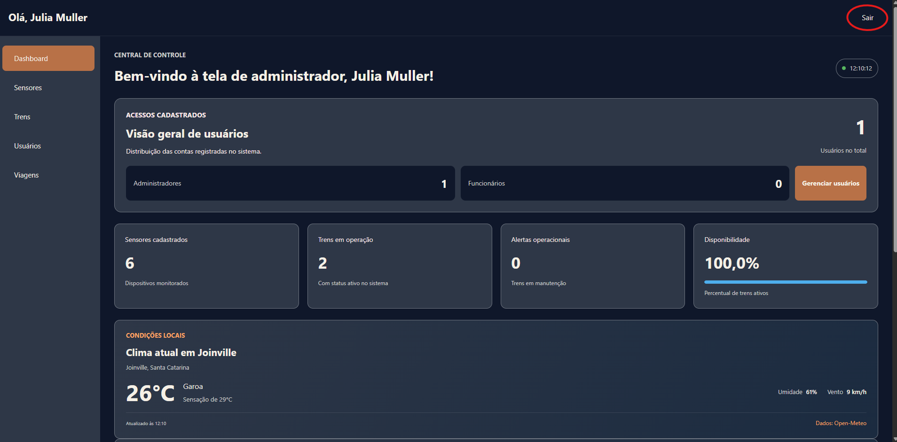

*Legenda: Opção utilizada para encerrar a sessão do usuário.*

---

# 5. Conhecendo a interface

Após realizar o login, o usuário terá acesso à interface principal do Ferrorama.

A interface foi organizada para facilitar a navegação entre as funcionalidades e permitir que as informações sejam encontradas de maneira simples.

### 5.1. Menu de navegação

O menu apresenta os acessos às principais áreas do sistema.

Entre as opções disponíveis estão:

- **Dashboard:** painel com informações gerais.
- **Usuários:** gerenciamento das contas cadastradas.
- **Trens:** gerenciamento dos veículos ferroviários.
- **Viagens:** gerenciamento dos registros de viagens.
- **Sensores:** gerenciamento dos equipamentos de monitoramento.

As opções apresentadas podem variar de acordo com o perfil de acesso.

### 5.2. Botões e ações

Durante a utilização do sistema, o usuário poderá encontrar diferentes botões para executar operações.

Os principais tipos de ações são:

- **Cadastrar:** abre um formulário para inserir um novo registro.
- **Salvar:** confirma o cadastro ou as alterações realizadas.
- **Editar:** permite modificar informações existentes.
- **Excluir:** solicita a remoção de um registro.
- **Pesquisar:** auxilia na localização de informações cadastradas.
- **Voltar:** retorna à tela anterior ou à listagem.

Antes de confirmar uma operação, confira sempre as informações apresentadas.

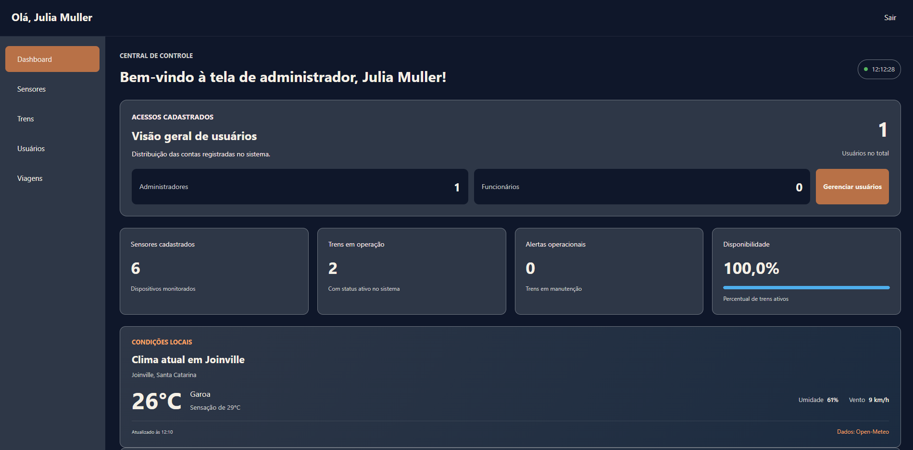 
*Legenda: Organização da interface e principais áreas de acesso.*

---

# 6. Dashboard

O dashboard é o painel principal do Ferrorama. Sua finalidade é apresentar informações gerais do sistema de maneira organizada e facilitar a visualização dos dados cadastrados.

Por meio dos indicadores e elementos visuais disponíveis, o usuário consegue acompanhar informações relacionadas aos registros do sistema.

### 6.1. Como acessar

1. Realize o login.
2. Localize a opção **Dashboard** no menu.
3. Clique para abrir o painel.
4. Observe os indicadores e informações apresentados.

### 6.2. Como interpretar as informações

Os indicadores devem ser interpretados conforme seus títulos e descrições.

Entre as informações que podem ser apresentadas estão:

- **Trens:** informações sobre a quantidade de veículos cadastrados e suas situações operacionais.
- **Sensores:** informações gerais sobre os equipamentos registrados.
- **Viagens:** dados relacionados aos registros de deslocamentos.
- **Gráficos e indicadores:** representações visuais que facilitam a compreensão dos dados.

### 6.3. Importância do dashboard

O dashboard permite consultar informações sem precisar abrir individualmente cada módulo do sistema.

Ele funciona como uma visão geral dos dados cadastrados, auxiliando na identificação e no acompanhamento das informações disponíveis.

---

# 7. Gerenciamento de usuários

O módulo de usuários permite administrar as contas cadastradas no Ferrorama.

Por meio dessa funcionalidade, o administrador pode inserir, consultar, editar e excluir usuários, respeitando as regras de acesso do sistema.

**Atenção:** o gerenciamento de contas é uma funcionalidade administrativa.

## 7.1. Acessar o módulo

1. Realize login com uma conta de administrador.
2. Localize a opção **Usuários** no menu.
3. Clique para abrir a listagem de usuários.

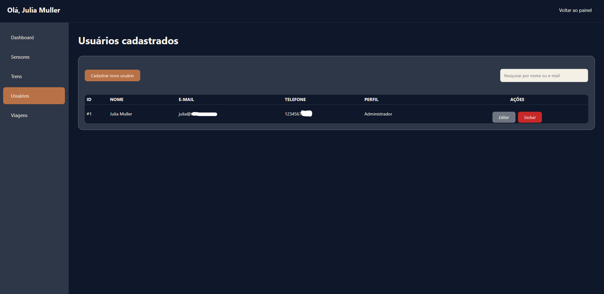

*Legenda: Listagem das contas cadastradas no sistema.*

## 7.2. Cadastrar um usuário

Para cadastrar uma nova conta:

1. Acesse o módulo **Usuários**.
2. Clique no botão de cadastro.
3. Preencha os campos solicitados.
4. Informe o nome do usuário.
5. Informe o e-mail.
6. Preencha o telefone, quando solicitado.
7. Selecione o tipo de usuário.
8. Confira as informações.
9. Clique em salvar.

O tipo de usuário determina as permissões que serão disponibilizadas para a conta.

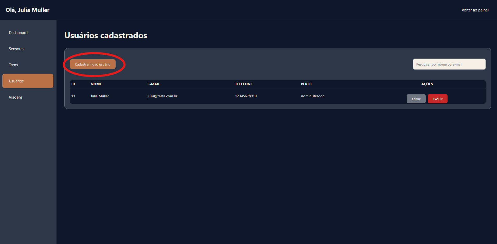

*Legenda: Botão  utilizado para inserir uma nova conta.*
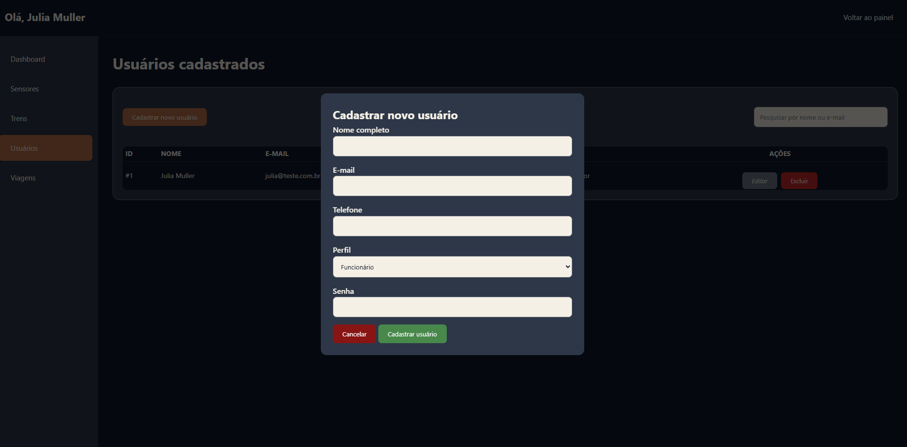
*Legenda: Formulário utilizado para inserir uma nova conta.*

## 7.3. Consultar usuários

Para consultar os registros:

1. Acesse a opção **Usuários**.
2. Observe a tabela apresentada.
3. Localize o usuário desejado.
4. Utilize o campo de pesquisa, quando necessário.
5. Consulte as informações disponíveis.

A listagem permite visualizar os dados cadastrados e identificar o perfil de cada conta.

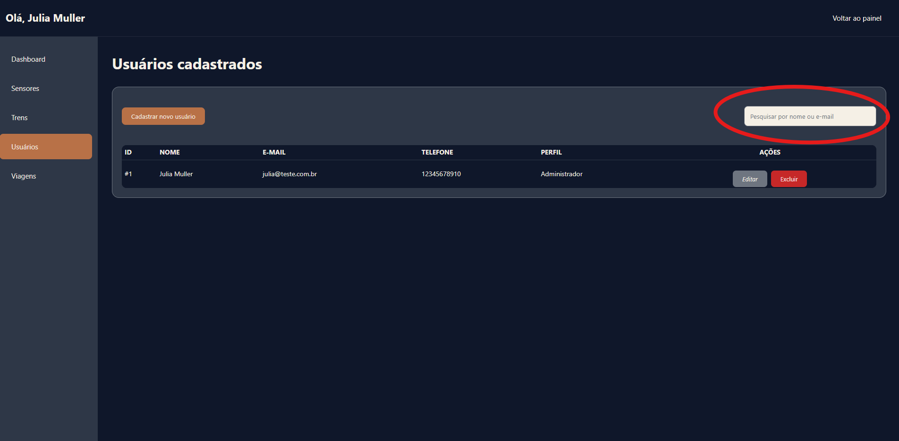

*Legenda: Exemplo de consulta de usuários cadastrados.*

## 7.4. Editar usuário

Para modificar um cadastro:

1. Localize o usuário na tabela.
2. Clique no botão de edição correspondente.
3. Aguarde a abertura do formulário.
4. Altere os campos necessários.
5. Confira as informações.
6. Clique em salvar.

Após a operação, as informações atualizadas deverão aparecer na listagem.

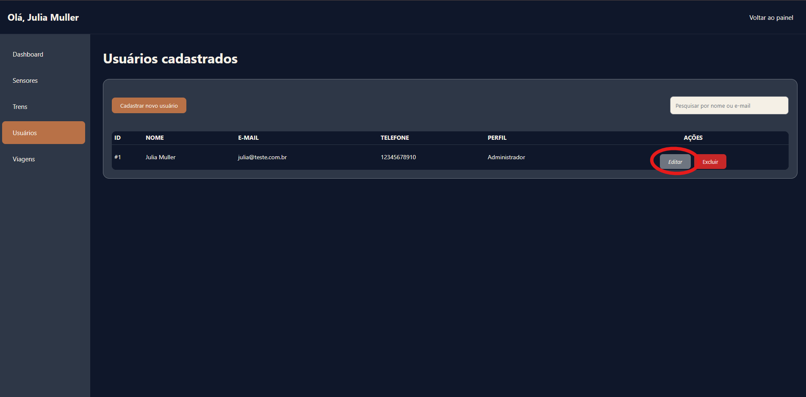
*Legenda: Botão  para a alteração das informações de uma conta cadastrada.*
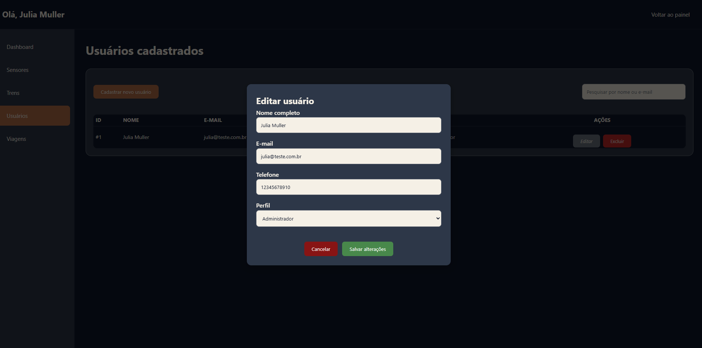
*Legenda: Alteração das informações de uma conta cadastrada.*

## 7.5. Excluir usuário

Para excluir um cadastro:

1. Localize o usuário desejado.
2. Clique na opção de exclusão.
3. Confira se o registro selecionado está correto.
4. Confirme a operação, caso seja solicitada.

A exclusão deverá respeitar as regras de segurança e os relacionamentos existentes no banco de dados.

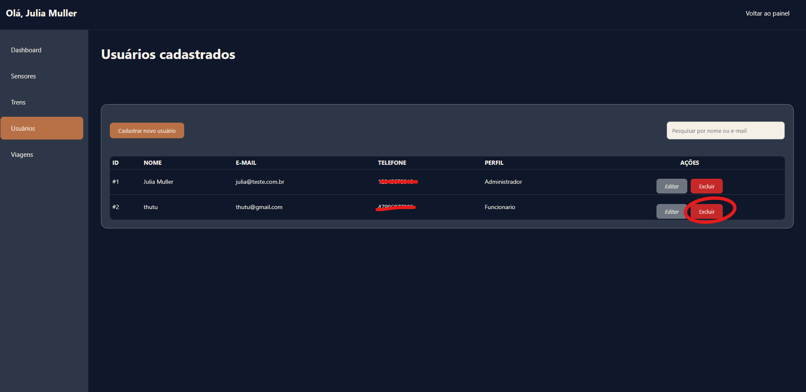
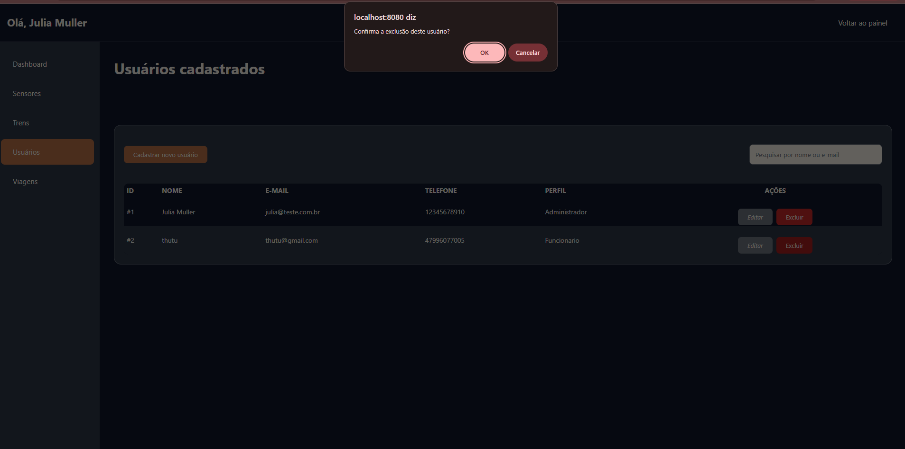
*Legenda: Operação de exclusão de uma conta.*

---

# 8. Gerenciamento de trens

O módulo de trens permite cadastrar e consultar informações dos veículos ferroviários registrados no sistema.

Esses registros ajudam a manter organizadas as informações de identificação, modelo, capacidade e situação operacional dos trens.

## 8.1. Acessar o módulo

1. Realize login com uma conta autorizada.
2. Localize a opção **Trens** no menu.
3. Clique para acessar a listagem.
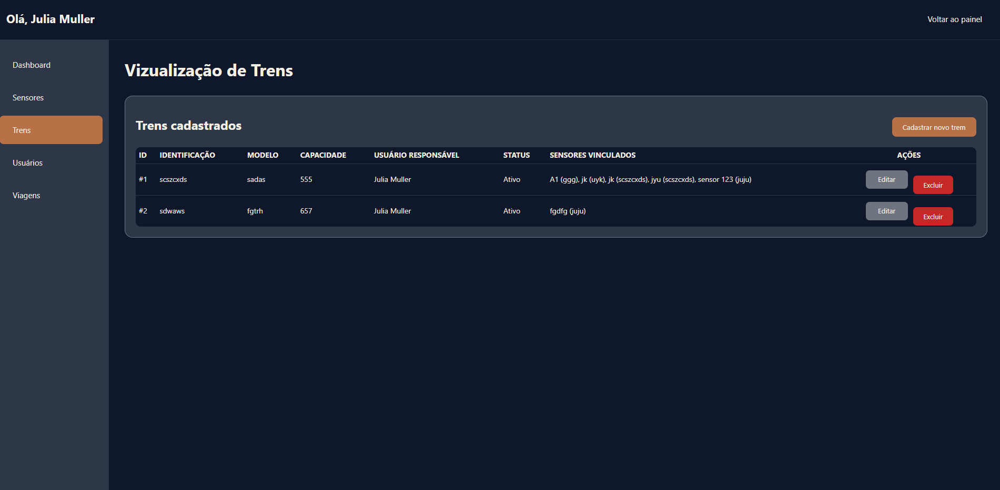

*Legenda: Relação dos trens cadastrados no Ferrorama.*

## 8.2. Cadastrar trem

Para inserir um novo trem:

1. Acesse o módulo **Trens**.
2. Clique no botão de cadastro.
3. Informe a identificação do trem.
4. Informe o modelo.
5. Preencha a capacidade.
6. Selecione a situação operacional disponível.
7. Confira as informações.
8. Clique em salvar.

A situação operacional permite identificar a condição registrada para o veículo, conforme as opções disponíveis no sistema.

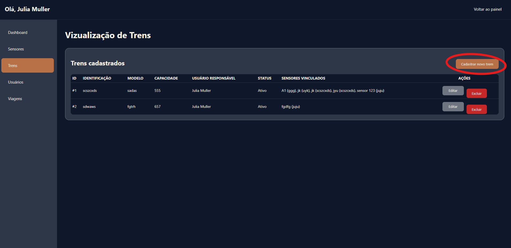

*Legenda: Preenchimento das informações de um novo trem.*

## 8.3. Editar trem

1. Localize o trem na listagem.
2. Clique na opção de edição.
3. Modifique as informações necessárias.
4. Confira os dados.
5. Clique em salvar.

## 8.4. Excluir trem

1. Localize o trem desejado.
2. Clique na opção de exclusão.
3. Confira o registro selecionado.
4. Confirme a operação, caso seja solicitada.

A exclusão pode depender da existência de registros relacionados, como sensores e viagens vinculados ao trem.

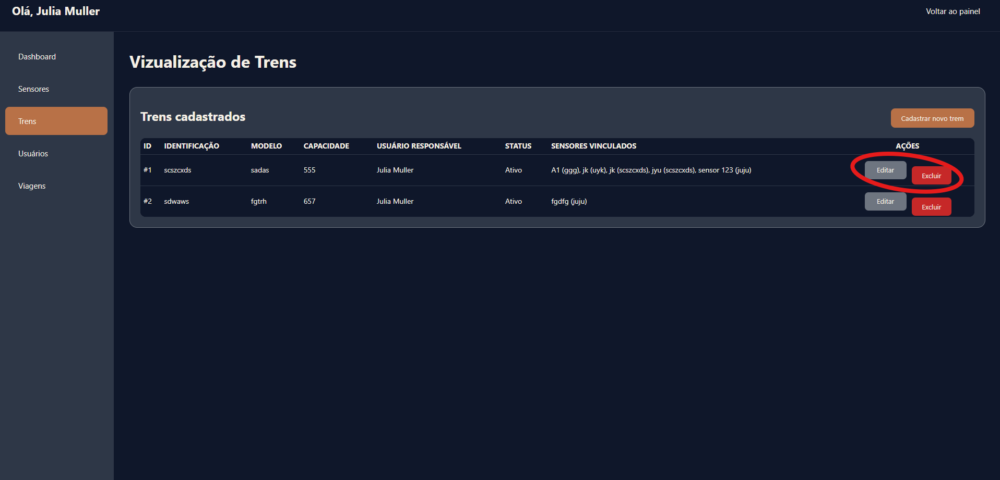

*Legenda: Ações disponíveis para administrar os registros de trens.*

---

# 9. Gerenciamento de viagens

O módulo de viagens permite registrar e consultar informações relacionadas aos deslocamentos ferroviários.

Cada registro mantém informações associadas ao trem utilizado e às datas correspondentes à viagem.

## 9.1. Acessar o módulo

1. Realize login com uma conta autorizada.
2. Localize a opção **Viagens** no menu.
3. Clique para abrir a listagem.

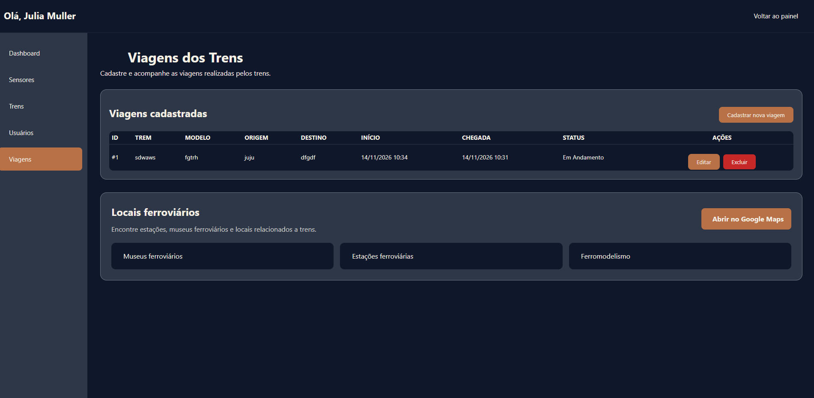

*Legenda: Tela de consulta dos registros de viagens.*

## 9.2. Cadastrar viagem

Para inserir uma nova viagem:

1. Acesse o módulo **Viagens**.
2. Clique no botão de cadastro.
3. Selecione o trem relacionado à viagem.
4. Informe a data de início.
5. Informe a data de chegada, quando solicitada.
6. Preencha os demais campos apresentados no formulário.
7. Confira as informações.
8. Clique em salvar.

É importante selecionar corretamente o trem relacionado para manter a associação entre os registros.

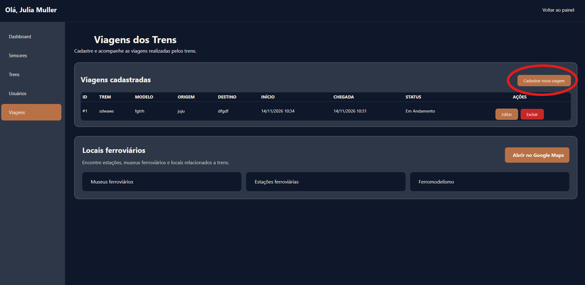
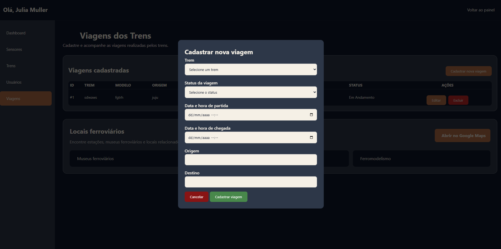
*Legenda: Registro de uma nova viagem e associação ao trem correspondente.*

## 9.3. Editar e excluir viagens

Para editar, localize o registro desejado, clique na opção de edição, altere as informações e salve.

Para excluir, localize a viagem, selecione a opção de exclusão e confirme a operação, caso seja solicitada.

Sempre confira os dados antes de realizar alterações ou exclusões.
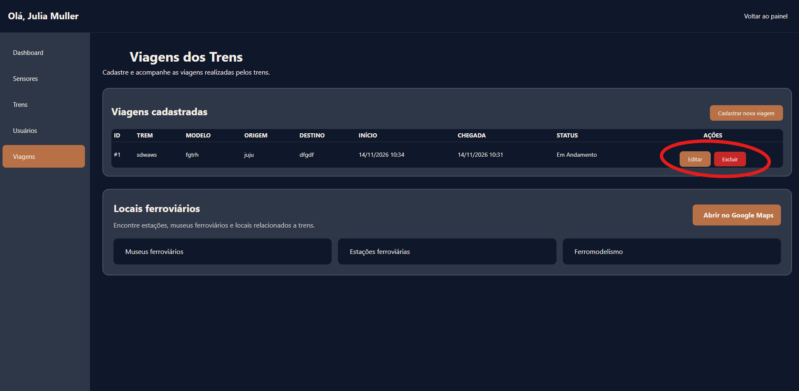
---

# 10. Gerenciamento de sensores

O módulo de sensores permite cadastrar e organizar os equipamentos relacionados ao monitoramento ferroviário.

Os sensores são associados aos trens, permitindo identificar a qual veículo cada equipamento pertence.

## 10.1. Cadastrar sensor

Para cadastrar um novo equipamento:

1. Acesse o módulo **Sensores**.
2. Clique no botão de cadastro.
3. Informe o nome do sensor.
4. Preencha sua identificação.
5. Informe a localização do equipamento.
6. Selecione o tipo de sensor disponível.
7. Escolha o trem ao qual o sensor será vinculado.
8. Confira as informações.
9. Clique em salvar.

A associação com o trem permite organizar os equipamentos de acordo com o veículo em que estão registrados.

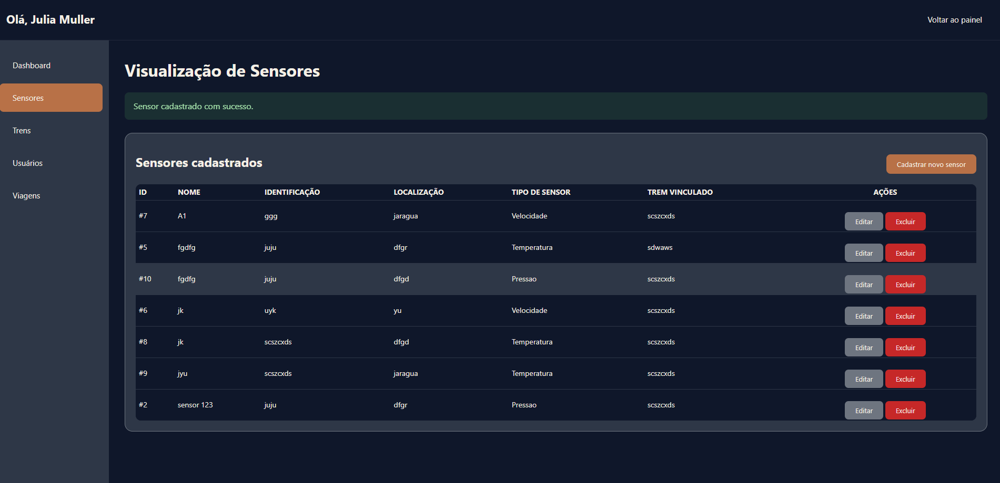

*Legenda: Cadastro de um equipamento e seleção do trem vinculado.*

## 10.2. Consultar sensores

Para consultar os sensores cadastrados:

1. Acesse a listagem de sensores.
2. Localize o equipamento desejado.
3. Consulte o nome e a identificação.
4. Verifique a localização.
5. Observe o tipo de sensor.
6. Confira o trem vinculado.

## 10.3. Editar sensor

1. Localize o sensor na listagem.
2. Clique na opção de edição.
3. Modifique as informações necessárias.
4. Confira o tipo de sensor e o trem associado.
5. Clique em salvar.

## 10.4. Excluir sensor

1. Localize o sensor desejado.
2. Clique na opção de exclusão.
3. Confira o registro selecionado.
4. Confirme a operação, caso seja solicitada.

A exclusão deve respeitar as regras e os relacionamentos existentes no sistema.
---

# 11. Perfis e permissões de acesso

O Ferrorama possui diferentes perfis de acesso para organizar as permissões e limitar determinadas operações.

## 11.1. Administrador

O administrador possui permissões administrativas para gerenciar os dados do sistema.

Entre suas responsabilidades estão:

- Cadastrar usuários.
- Consultar usuários.
- Editar contas cadastradas.
- Excluir usuários conforme as regras do sistema.
- Gerenciar trens.
- Gerenciar viagens.
- Gerenciar sensores.
- Acessar as funcionalidades administrativas disponibilizadas.

## 11.2. Funcionário

O funcionário possui acesso às funcionalidades disponibilizadas para seu perfil.

Esse perfil é destinado à utilização das áreas operacionais permitidas, sem autorização para administrar as contas de usuários.

As opções disponíveis podem ser diferentes das apresentadas ao administrador.

## 11.3. Importância do controle de acesso

A separação dos perfis ajuda a proteger as informações e evita que usuários sem autorização realizem operações administrativas.

As permissões devem ser respeitadas tanto na interface quanto nas operações realizadas pelo servidor.

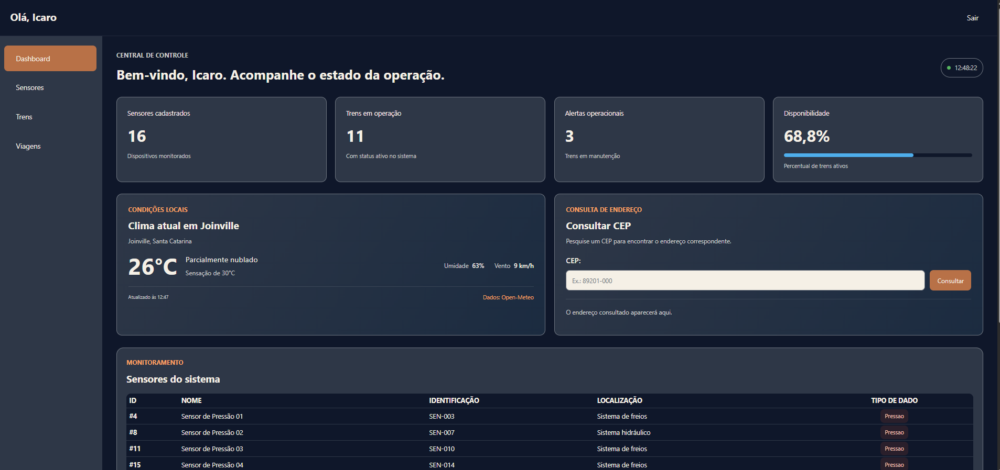 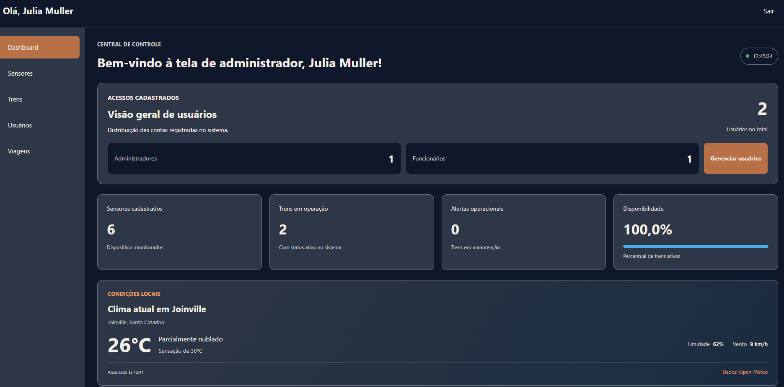

*Legenda: Diferenças entre as opções disponibilizadas para cada perfil.*

---

# 12. Mensagens e orientações do sistema

Durante a utilização, o Ferrorama poderá apresentar mensagens para informar o resultado das operações.

Essas mensagens ajudam o usuário a compreender o que aconteceu após executar determinada ação.

### 12.1. Mensagens de sucesso

São apresentadas quando uma operação é concluída corretamente.

Exemplos:

- Cadastro realizado com sucesso.
- Informações atualizadas.
- Registro excluído com sucesso.

### 12.2. Mensagens de erro

São apresentadas quando alguma operação não pode ser concluída.

Isso pode acontecer quando:

- Um campo obrigatório não foi preenchido.
- Uma informação está em formato inválido.
- O usuário não possui permissão para executar determinada ação.
- Existe algum problema com o registro selecionado.
- Ocorre uma falha na comunicação com o servidor ou banco de dados.

Quando uma mensagem de erro aparecer, leia sua descrição e verifique as informações antes de tentar novamente.

### 12.3. Mensagens de confirmação

Algumas operações podem solicitar confirmação antes de serem executadas, principalmente aquelas que envolvem exclusão de registros.

Antes de confirmar, verifique se o registro selecionado é realmente aquele que deseja alterar ou excluir.

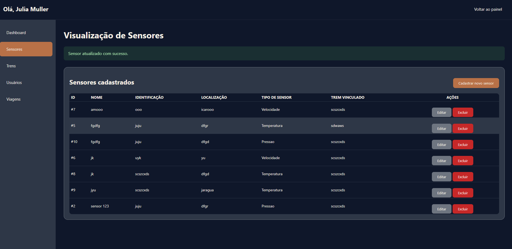
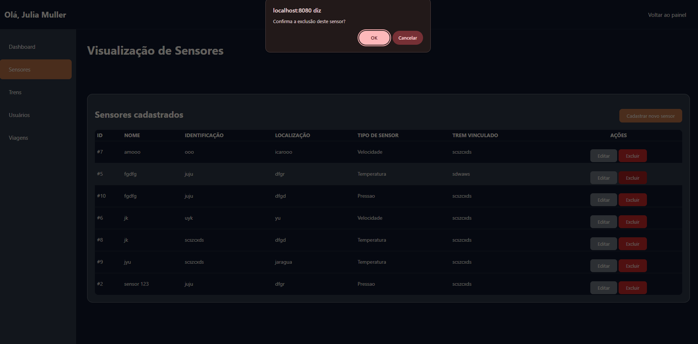

*Legenda: Retornos apresentados pelo sistema durante as operações.*

---

# 13. Boas práticas de utilização

Para garantir uma utilização adequada do Ferrorama, recomenda-se seguir algumas orientações:

- Utilize somente sua própria conta de acesso.
- Não compartilhe suas credenciais com outras pessoas.
- Confira os dados antes de salvar um cadastro.
- Verifique as informações antes de realizar alterações.
- Tenha atenção ao excluir registros.
- Utilize os campos de pesquisa para facilitar a localização das informações.
- Respeite as permissões do seu perfil.
- Encerre a sessão ao finalizar a utilização.
- Não tente acessar funcionalidades administrativas sem autorização.

A utilização correta contribui para manter os registros organizados e evitar alterações indevidas.

---

# 14. Solução de problemas comuns

Esta seção apresenta algumas situações que podem ocorrer durante o uso do sistema e orientações iniciais para resolvê-las.

| Problema | Orientação |
|---|---|
| O sistema não abre | Verifique se o Apache está iniciado e se o endereço está correto. |
| Não é possível realizar login | Confira o e-mail e a senha cadastrados. |
| A página apresenta erro de conexão | Verifique se o MySQL está funcionando. |
| O cadastro não é concluído | Confira os campos obrigatórios e as informações preenchidas. |
| Não é possível excluir um registro | Verifique se existem relacionamentos que impedem a exclusão. |
| Uma funcionalidade não aparece | Confira se seu perfil possui autorização para acessá-la. |
| As informações não aparecem na tabela | Atualize a página e confira se o cadastro foi concluído corretamente. |

Caso o problema continue, a equipe responsável pela manutenção do sistema deverá verificar a situação.

---

# 15. Considerações finais

O Ferrorama foi desenvolvido para auxiliar no gerenciamento e na organização de informações relacionadas ao ambiente ferroviário.

Este manual apresenta as orientações necessárias para que novos usuários consigam acessar a aplicação, compreender sua interface e utilizar as principais funcionalidades disponíveis.

A organização dos módulos, a separação dos perfis de acesso e a integração com o banco de dados contribuem para uma utilização mais estruturada do sistema.

**Ferrorama — Organização, gerenciamento e tecnologia aplicados ao ambiente ferroviário.**

---

*Documento referente à versão 1.0.0 do sistema Ferrorama.*